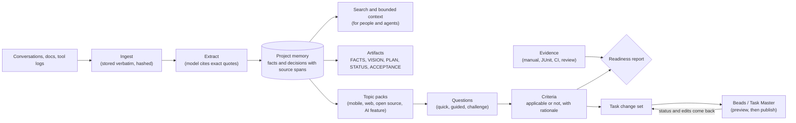
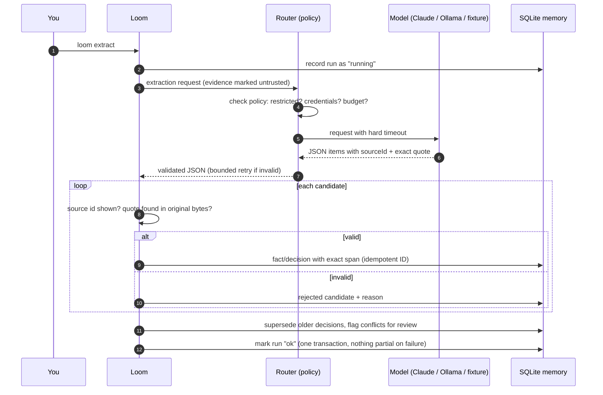
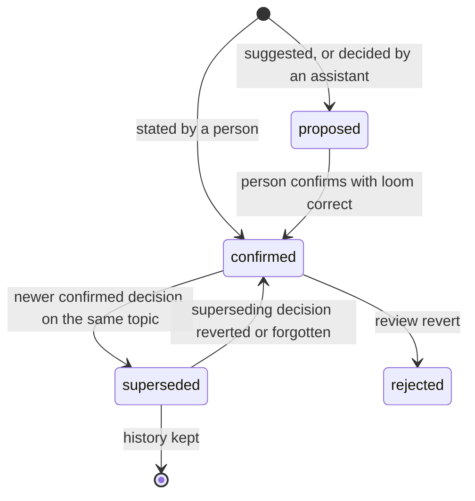
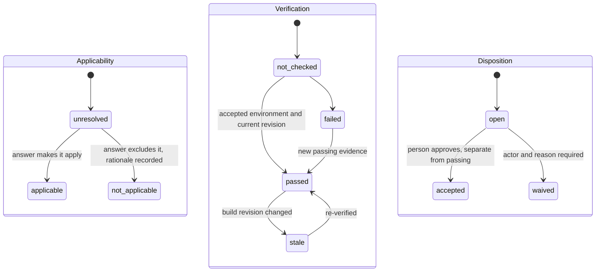
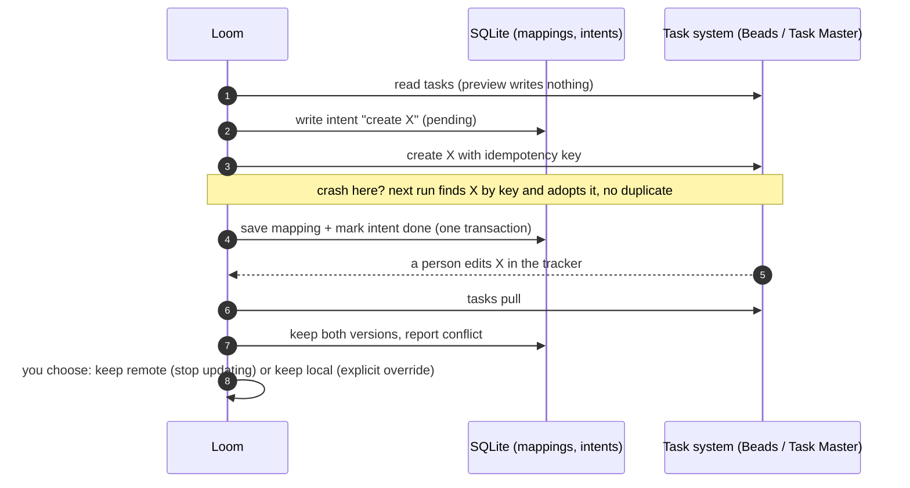
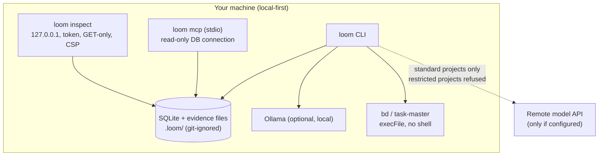
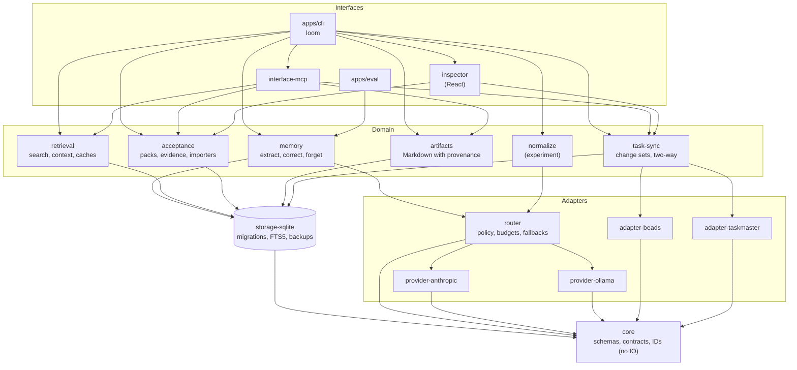

# Context Loom (working name) — AI Plugin Toolkit

**Traceable project memory, evidence-based acceptance and task sync for AI-assisted delivery.**

`#ai` `#llm` `#agents` `#project-memory` `#rag` `#provenance` `#acceptance-testing` `#mcp` `#claude` `#ollama` `#local-first` `#sqlite` `#typescript` `#nodejs` `#cli` `#beads` `#task-master` `#developer-tools` `#open-source`

> **Status: 0.4.0 release candidate, not published, not fully release-ready.** Core features (v0.1–v0.4) are implemented. Release verification requires current execution receipts for both task adapters, real Claude/Ollama extraction, and a clean macOS installation. A license choice and publication are also pending. See [What is left](#what-is-left).

---

## Contents

- [Why does this exist?](#why-does-this-exist)
- [What it does](#what-it-does)
- [How it works](#how-it-works)
- [Quick start](#quick-start)
- [Commands at a glance](#commands-at-a-glance)
- [Configuration](#configuration)
- [Architecture](#architecture)
- [Guarantees and how they are tested](#guarantees-and-how-they-are-tested)
- [Is it ready?](#is-it-ready)
- [What is left](#what-is-left)
- [Documentation](#documentation)

---

## Why does this exist?

When you build software with AI assistants, most of the important information lives in **conversations**: what the product is, what was decided, what was rejected, what "done" means. That information decays quickly.

| Problem | What happens without a tool like this |
| --- | --- |
| **Decisions get lost** | Two weeks later nobody remembers whether "use PostgreSQL" was a decision or one assistant's suggestion. The agent re-proposes things that were already rejected. |
| **AI summaries cannot be checked** | A summary says "the team decided X", but there is no link back to who said it, where, or whether it was a proposal. |
| **Context windows are limited and costly** | Pasting whole chat histories into every prompt is expensive, slow, and leaks unrelated project data. |
| **"Task closed" is mistaken for "done"** | A ticket marked closed, or a test run on an emulator, gets reported as "release ready". Nobody checked whether the evidence actually covers the requirement. |
| **Requirements are forgotten** | Release checklists (privacy, accessibility, purchases, offline behaviour) are remembered only when something breaks. |
| **Tools do not talk to each other** | Plans live in chats, tasks live in a tracker, evidence lives in CI. Copying between them duplicates work and overwrites human edits. |

Context Loom keeps a **verifiable project memory** next to your work:

- Every fact and decision **cites the exact text** it came from, and you can open that text.
- A **proposal is never a decision**, and an assistant cannot "decide" anything on your behalf.
- Acceptance is judged **only from evidence**: the right environment, the current build revision, never just a closed task.
- Tasks are **published to the tracker you already use** (Beads, Task Master), and your manual edits there are never silently overwritten.
- It is **local-first**: SQLite in your project. Remote models are used only as configured, and restricted projects can never reach them.

In short, it answers: *what do we know, what was decided, what changed, what is still unanswered, what should happen next, and what evidence supports delivery?*

---

## What it does



| Capability | Example |
| --- | --- |
| Source-linked memory | `loom memory show dec_…` prints the decision **and** the exact quote, speaker and source. |
| Proposal vs decision | "PostgreSQL is one option" (assistant) stays *proposed*; "Decision: SQLite" (user) is *confirmed*. |
| Corrections with history | `loom correct storage "SQLite + iCloud" --reason "…"` supersedes the old decision and keeps it. |
| Scoped, bounded context | `loom context offline reminders --max-chars 1200` never exceeds the limit or crosses projects. |
| Evidence-based acceptance | Emulator evidence does not pass a physical-device criterion; a new build revision makes old passes *stale*. |
| Honest waivers | `loom waive <criterion> --reason …` is shown as *waived*, never as *passed*. |
| Task sync without surprises | `loom tasks preview` writes nothing; `sync` is idempotent and survives crashes; remote edits are kept. |
| Forgetting | `loom forget <source> --yes` removes everything derived from the source and scrubs the database file. |
| Agents and people | `loom mcp` serves memory to agents (read-only by default); `loom inspect` is a local web UI. |

---

## How it works

### 1. Extraction you can verify

The model never invents offsets. It returns a **quote**, and Loom checks that the quote exists in the source before anything is stored.



### 2. Decisions have a lifecycle



### 3. Acceptance is three separate signals

Applicability, verification and disposition are tracked independently, so "approved by a person", "technically verified" and "not relevant" never blur together.



A closed task, a mock, or an emulator run for a physical-device requirement **never** moves verification to `passed`.

### 4. Task sync that survives crashes and respects edits



The task system **owns status**. Loom reads it back but never closes tasks.

### 5. Security boundaries



---

## Quick start

Requirements: **Node.js ≥ 22.13** and **pnpm 10** (`corepack enable`).

```bash
pnpm install --frozen-lockfile
pnpm build
pnpm test
```

Run the offline end-to-end demo on synthetic data (no credentials, no network):

```bash
bash examples/synthetic/demo.sh /tmp/loom-demo
```

Open the read-only inspector for that demo:

```bash
node apps/cli/dist/main.js inspect --dir /tmp/loom-demo
```

Put `loom` on your PATH (optional):

```bash
pnpm bundle && npm install -g ./dist-release/loom
```

Use Claude for extraction (key read from the environment, never stored):

```bash
export ANTHROPIC_API_KEY=...
loom init --provider anthropic
```

Fully local with Ollama (nothing leaves the machine):

```bash
loom init --provider ollama --model llama3.1:8b --embeddings ollama
```

Full walkthrough: [docs/quickstart.md](docs/quickstart.md).

---

## Commands at a glance

| Area | Commands |
| --- | --- |
| Project | `init`, `config validate` |
| Evidence and memory | `ingest`, `sources list/show`, `extract`, `memory list/show/confirm/reject`, `search [--semantic]`, `context`, `embed`, `cache stats/clear`, `normalize` |
| Corrections and lifecycle | `correct`, `review list/resolve`, `forget --yes`, `export`, `import`, `retention show/apply` |
| Artifacts | `generate [facts vision plan status acceptance decisions]` |
| Acceptance | `assess --pack <id> \| --pack-file`, `questions --mode quick\|guided\|challenge`, `answer`, `criteria list`, `evidence add/import`, `waive`, `accept`, `reopen`, `revision set [--from-git]`, `report [--require-ready]` |
| Tasks | `tasks init/preview/sync/list/pull/conflicts/resolve` |
| Agents and UI | `mcp`, `inspect` |
| Database | `db status/backup/restore` |

All commands accept `--json`. Without `--dir`, `loom` uses the nearest parent directory that contains `loom.config.json`. Exit codes: `0` success, `1` failed or not ready, `2` usage, `70` internal.

---

## Configuration

`loom.config.json` (created by `loom init`) holds **no secrets**: credentials are referenced by environment-variable name only, and the schema rejects literal keys.

```json
{
  "$schemaVersion": 1,
  "project": { "id": "habit", "name": "Habit tracker", "sensitivity": "standard" },
  "providers": {
    "claude": { "adapter": "anthropic", "location": "remote", "model": "claude-opus-5-5", "apiKeyEnv": "ANTHROPIC_API_KEY" },
    "local": { "adapter": "ollama", "location": "local", "baseUrl": "http://127.0.0.1:11434", "model": "llama3.1:8b" }
  },
  "routing": {
    "extraction": { "providers": ["claude", "local"], "timeoutMs": 120000, "maxAttempts": 2, "maxCostUsd": 1 }
  },
  "tasks": { "adapter": "beads", "allowWrites": false },
  "mcp": { "allowWrites": false },
  "retention": { "sourceMaxAgeDays": 365 }
}
```

- The first provider is primary; the rest are the **only** permitted fallbacks.
- `"sensitivity": "restricted"` refuses any remote provider, both at validation and at call time.
- Writes to task systems and from MCP clients are **off** until you enable them.

---

## Architecture



`core` imports no implementations (enforced by a test). Providers and task adapters declare capabilities, and anything undeclared fails explicitly instead of pretending to succeed.

| Package | Responsibility |
| --- | --- |
| `packages/core` | Validated schemas, config, stable IDs, plugin contracts, typed errors, redaction |
| `packages/storage-sqlite` | Built-in `node:sqlite`, append-only migrations, FTS5, caches, embeddings, backups |
| `packages/router` | Policy routing for completions and embeddings; fixture provider; hashing embedder |
| `packages/provider-anthropic` / `provider-ollama` | Claude (official SDK) / local Ollama chat and embeddings |
| `packages/memory` | Quote-cited extraction, corrections, review, forgetting, export/import |
| `packages/retrieval` | Project-scoped search, bounded context, revision-keyed caches, hybrid search |
| `packages/normalize` | Opt-in plain-English rewrite with meaning checks (no compliance claim) |
| `packages/acceptance` | Topic packs, questions, evidence evaluation, JUnit/CI/review importers |
| `packages/artifacts` | FACTS / VISION / PLAN / STATUS / ACCEPTANCE + decision records |
| `packages/task-sync` | Derivation, previews, durable intents, conflict handling, two-way pull |
| `packages/adapter-beads` / `adapter-taskmaster` | Beads 1.3.x / Task Master 0.43.x via their CLIs |
| `packages/interface-mcp` | MCP server over stdio |
| `packages/inspector` | Read-only local web inspector |
| `apps/cli`, `apps/eval` | The `loom` command; reproducible evaluation (`pnpm eval`) |

Design decisions are recorded in [docs/adr/](docs/adr/).

---

## Guarantees and how they are tested

| Guarantee | Test evidence |
| --- | --- |
| Every claim resolves to exact source text; invented sources and quotes are rejected | `packages/memory/test/extract.test.ts` |
| Proposal ≠ decision; corrections keep history | `extract.test.ts`, `lifecycle.test.ts`, CLI workflow 4 |
| No cross-project retrieval or cache hits; caches invalidated on memory/permission change | `packages/retrieval/test/*.test.ts` |
| Generated docs never overwrite hand edits | `packages/artifacts/test/artifacts.test.ts` |
| Closed task, mock or emulator evidence never passes a physical-device criterion; stale on new revision | `packages/acceptance/test/*.test.ts` |
| Preview writes nothing; publish twice = no duplicates; crash mid-sync = no duplicates; remote edits kept | `packages/task-sync/test/*` (shared scenarios) |
| Restricted projects never reach remote providers; timeouts are bounded | `packages/router/test/router.test.ts` |
| Fully local workflow with outside network blocked | `apps/cli/test/local.test.ts` |
| Forgetting removes derived data and scrubs the database file | `packages/memory/test/lifecycle.test.ts`, CLI workflow 5 |
| MCP read tools cannot write | `packages/interface-mcp/test/mcp.test.ts` |
| Inspector: traces, keyboard, axe accessibility, phone width | `packages/inspector/test/inspector.test.ts` (Playwright) |

Acceptance scenarios A01–A27 are mapped in the [test plan](.tasks/test-plan/CONTEXT-LOOM-ACCEPTANCE.md).

---

## Is it ready?

**Feature-complete, not release-complete.**

| Area | State |
| --- | --- |
| Code for v0.1–v0.4 and the release gate | ✅ implemented; automated build/test workflows on Node 22 and 24 |
| Offline demo, bundled CLI, clean-clone install | ✅ verified |
| Beads adapter against a real `bd` | ⏳ written and unit-tested; **not run against the real tool** |
| Task Master adapter against a real `task-master` | ⏳ written and unit-tested; **not run against the real tool** |
| Live model runs (Claude, real Ollama) | ⏳ tested against local stand-ins only |
| License | ⏳ owner decision pending (no `LICENSE` file yet) |
| Publication (public repo, npm) | ⏳ not done, explicit final step |

Do not rely on the task-tracker integration in production until the real-tool runs pass.

---

## What is left

1. Install `bd` 1.3.x and `task-master-ai` 0.43.x; run `pnpm verify:release -- beads` and `pnpm verify:release -- taskmaster` to record real execution evidence.
2. Choose a license and add `LICENSE` ([docs/release.md](docs/release.md) compares MIT and Apache-2.0).
3. Run `pnpm verify:release -- anthropic`, `ollama`, and `macos` with the required model environment variables and host. The gate requires all five receipts to match the current source snapshot; see [execution evidence](docs/release.md#execution-evidence-required-for-ready).
4. `pnpm release:check` must print `READY` without pending exceptions. Human review of the evaluation datasets, advisory pack items, and a screen-reader pass remain recommended.
5. Review, merge, tag `v0.4.0`, then publish (only with explicit authorisation).

The full list is in [plan §14](.tasks/plans/CONTEXT-LOOM-IMPLEMENTATION-PLAN.md#14-remaining-work-as-of-2026-11-02).

---

## Documentation

| Topic | Link |
| --- | --- |
| Quickstart | [docs/quickstart.md](docs/quickstart.md) |
| Data lifecycle (corrections, forgetting, backups) | [docs/data-lifecycle.md](docs/data-lifecycle.md) |
| MCP server | [docs/mcp.md](docs/mcp.md) |
| Inspector | [docs/inspector.md](docs/inspector.md) |
| Normalization experiment | [docs/normalization.md](docs/normalization.md) |
| Adapters | [Beads](docs/adapters/beads.md) · [Task Master](docs/adapters/task-master.md) |
| Compatibility | [docs/compatibility.md](docs/compatibility.md) |
| Release gate | [docs/release.md](docs/release.md) |
| Architecture decisions | [docs/adr/](docs/adr/) |
| Vision, plan, tickets, test plan | [.tasks/](.tasks/README.md) |
| Changelog · Security · Contributing | [CHANGELOG.md](CHANGELOG.md) · [SECURITY.md](SECURITY.md) · [CONTRIBUTING.md](CONTRIBUTING.md) |

---

*Context Loom is a working name. No benchmark, cost-saving or standards-compliance claim is made; all examples use synthetic data.*
